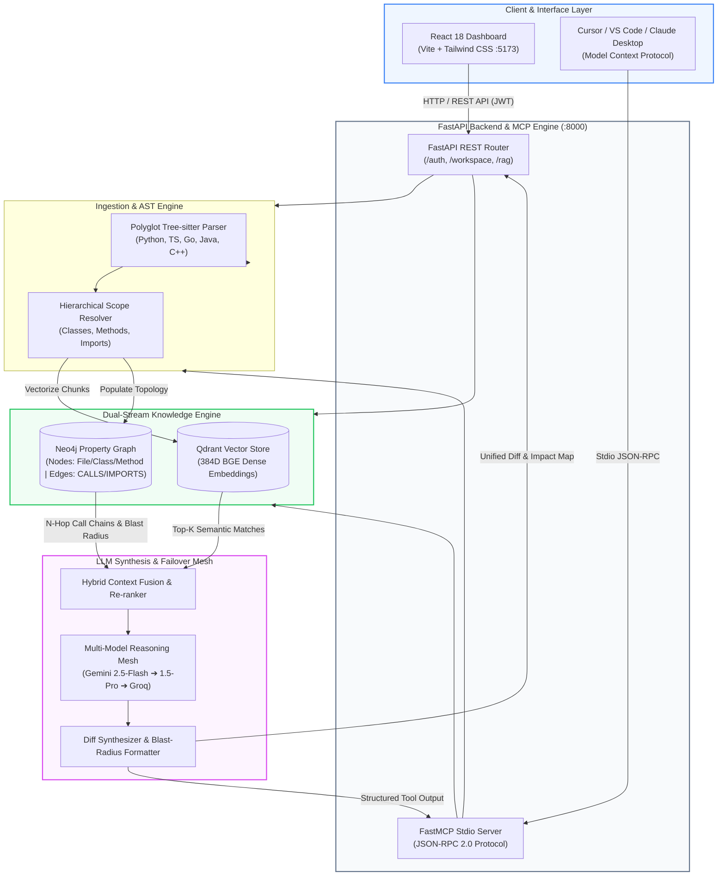
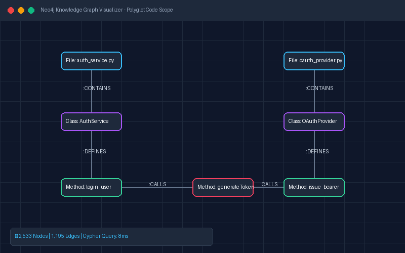
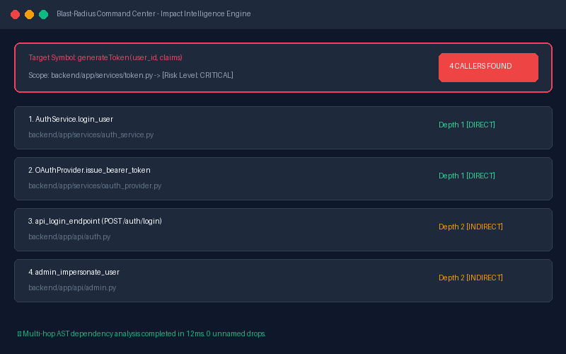

<div align="center">

# 🚀 CodeGraph-RAG
### Autonomous Polyglot Codebase Intelligence & Blast-Radius Engine

*A Production-Grade Full-Stack Monorepo Pairing Deterministic AST Knowledge Graphs with High-Dimensional Vector Search & Model Context Protocol (MCP).*

<br/>

[](https://youtube.com)
[](https://your-live-demo-url.com)
[](https://www.linkedin.com/in/appikatlaharshavardhan/)

<br/>

[](https://www.python.org/)
[](https://fastapi.tiangolo.com/)
[](https://react.dev/)
[](https://tree-sitter.github.io/)
[](https://neo4j.com/)
[](https://qdrant.tech/)
[](https://ai.google.dev/)
[](https://modelcontextprotocol.io/)
[](https://www.docker.com/)
[](./LICENSE)
[](https://github.com/HarshaAppikatla/CodeGraph-RAG/pulls)

<br/>

[Key Features](#-key-features) •
[The Core Problem](#-the-core-problem-solved) •
[Quick Example](#-quick-example-programmatic-blast-radius-check) •
[System Architecture](#️-system-architecture) •
[Visual Preview](#️-visual-dashboard--blast-radius-preview) •
[Tech Stack](#️-complete-tech-stack-matrix) •
[MCP Tools](#-exposed-mcp-tools) •
[Monorepo Structure](#-monorepo-directory-structure) •
[1-Click Quickstart](#-1-click-quickstart-with-docker-compose) •
[Benchmarks](#-system-performance-benchmark) •
[Author & License](#-author--contact)

<br/>

</div>

> ### 💡 What is CodeGraph-RAG? (TL;DR)
> **CodeGraph-RAG** is Google Maps for your codebase. Traditional AI coding assistants search for text snippets, but remain blind to execution flows—leading to broken code during refactoring. CodeGraph-RAG combines **Tree-sitter AST parsing** and **Neo4j Property Knowledge Graphs** with **Embedded Qdrant Vector Search** to map every function caller, predict the exact **blast radius** of any code change, and feed zero-hallucination context directly into **Cursor, VS Code, and Claude Desktop** via the Model Context Protocol (MCP).

---

## 🌟 Key Features

- **🌐 Polyglot Scope-Resolved AST Traversal**: Uses Tree-sitter parsers across Python, Java, TypeScript, C++, and Go to build deterministic abstract syntax trees, identifying precise class scopes, function signatures, docstrings, and cross-file import statements.
- **🕸️ Deterministic Property Knowledge Graphs**: Ingests files, classes, methods, and call sites into **Neo4j** with bi-directional relationships (`[:CONTAINS]`, `[:CALLS]`, `[:EXTENDS]`, `[:IMPORTS]`), unlocking instant $N$-hop multi-level blast-radius analysis.
- **⚡ Dual-Stream Context Retrieval**: Merges high-dimensional dense code vector search (**Qdrant** + local 384D BGE / 3072D Gemini embeddings) with structural graph traversal context to completely eliminate code-hallucination.
- **🤖 Autonomous Refactor & Patch Synthesizer**: Produces unified Git patches (`--- a/` / `+++ b/`) tailored to codebase architecture, simulating impacts before changes are committed.
- **🔌 Native Model Context Protocol (MCP)**: Exposes a standardized stdio JSON-RPC 2.0 interface for instantaneous integration with **VS Code**, **Cursor IDE**, and **Claude Desktop**.
- **🛡️ Multi-Tier Resilient Model Failover**: Built-in automatic retry and fallback across production models (`gemini-2.5-flash`, `gemini-1.5-pro`, Groq LLaMA 3.3) with dynamic model discovery and cooldowns to gracefully mitigate quota (`429`) and server (`503`) rate limits.
- **📊 Blast-Radius Command Center**: Visualizes impact assessment, affected callers, and dependency chains in an interactive React 18 dashboard.

---

## 🎯 The Core Problem Solved

Standard Code RAG systems rely strictly on naive chunked vector embeddings. When applied to production-scale codebases, this introduces severe **context fragmentation**:

> [!WARNING]
> ### 🛑 The Vector Blindspot
> Vector search excels at finding *textually similar* fragments, but is fundamentally blind to execution flows:
> * It **cannot** answer: *"If I modify function `generateToken()`, which 4 upstream controllers and service layers will break?"*
> * It misses indirect callers, inheritance overrides, and cross-file interface implementations.
> * It splits function signatures away from their enclosing class scopes and global decorators.

> [!TIP]
> ### 💡 The Graph-Augmented Solution
> **CodeGraph-RAG** pairs semantic vector retrieval with a deterministic **Neo4j Property Knowledge Graph**:
> * **Deterministic Scope Attribution**: Every code chunk is tagged with its fully-qualified hierarchical identifier (`package.Class.method`).
> * **Multi-Hop Dependency Traversal**: Cypher queries trace call graphs upstream and downstream to arbitrary depths ($N$-hops).
> * **Contextual Fusion**: LLM prompts receive both relevant semantic snippets and exact architectural dependency paths.

### ⚖️ Comparison Matrix

| Capability | Naive Vector-Only RAG | Graph-Only Retrieval | 🚀 CodeGraph-RAG (Dual Stream) |
| :--- | :---: | :---: | :---: |
| **Semantic Keyword & Intent Search** | ✅ High | ❌ None | ✅ **Optimal (Qdrant + BGE)** |
| **Blast Radius & Impact Analysis** | ❌ Fails (Hallucinates) | ✅ Strong | ✅ **100% Deterministic (Neo4j)** |
| **Caller / Callee Hierarchy Tracing** | ❌ Incomplete | ✅ Exact | ✅ **Exhaustive Multi-Hop** |
| **Enclosing Scope Awareness** | ❌ Chunks Cut Arbitrarily | ✅ Structural | ✅ **Exact Class & Method Mapping** |
| **Unified Patch / Diff Generation** | ⚠️ Fragmented | ❌ Code Unaware | ✅ **Architectural-Aligned Diffs** |
| **IDE Agent Integration (MCP)** | ⚠️ Custom / Partial | ⚠️ Custom / Partial | ✅ **Standard Stdio JSON-RPC 2.0** |

---

## ⚡ Quick Example: Programmatic Blast-Radius Check

Query the graph engine programmatically without booting the full web UI:

```python
from backend.app.services.graph_store import CodeGraphStore

# Connect to local or cloud Neo4j graph instance
graph = CodeGraphStore(uri="bolt://localhost:7687", auth=("neo4j", "password"))

# Calculate N-hop blast radius for any symbol across the codebase
impact = graph.get_blast_radius(symbol_name="generateToken", max_depth=3)

print(f"🔥 Blast Radius: {impact['total_affected_callers']} upstream callers across {len(impact['affected_files'])} files.")
# Output: 🔥 Blast Radius: 4 upstream callers across 4 files.
```

---

## 🏗️ System Architecture

### End-to-End Architectural Pipeline



<details>
<summary><b>📐 Text-Based ASCII Architecture View (Click to expand)</b></summary>
<br/>

```text
                      ┌─────────────────────────────────┐
                      │ Developer / Web / Cursor / IDE  │
                      └────────────────┬────────────────┘
                                       │
            ┌──────────────────────────┴──────────────────────────┐
            ▼                                                     ▼
  [ React 18 SPA Dashboard ]                           [ FastMCP Stdio Server ]
   (Port 5173 - Tailwind)                               (JSON-RPC 2.0 Engine)
            │                                                     │
            │ REST API (Bearer JWT)                               │ Service Calls
            ▼                                                     │
  ┌─────────────────────────────────────────────────────┐         │
  │               FastAPI Backend Server                │         │
  │                     (Port 8000)                     │         │
  ├─────────────────────────────────────────────────────┤         │
  │ • /api/auth/*       : Session & JWT Provider        │         │
  │ • /api/workspace/*  : Git Ingestion & AST Pipeline  │◄────────┘
  │ • /api/rag/impact   : N-Hop Blast Radius Traversal  │
  │ • /api/rag/query    : Dual-Stream Context Fusion    │
  │ • /api/rag/refactor : Automated Patch Synthesizer   │
  └──────────────────────────┬──────────────────────────┘
                             │
            ┌────────────────┴────────────────┐
            ▼                                 ▼
 [ Polyglot AST Parser ]          [ Dual-Stream Knowledge Layer ]
  Tree-sitter Scope Engine            ┌───────────────┴───────────────┐
  Python, TS, Go, Java, C++           ▼                               ▼
                             [ Qdrant Vector DB ]         [ Neo4j Graph DB ]
                             (384D BGE Vectors)           (Property Graph)
                             Semantic Search              Multi-Hop Blast Radius
                                      │                               │
                                      └───────────────┬───────────────┘
                                                      ▼
                                           [ Gemini Reasoning Mesh ]
                                           (Automatic Model Failover)
```

</details>

---

## 🖼️ Visual Dashboard & Blast-Radius Preview

| Interactive Dependency Visualizer | Deterministic Blast-Radius Analysis |
| :---: | :---: |
|  |  |
| *Real-time force-directed topology of files, classes, and method call sites* | *Multi-hop upstream caller tracing and broken-file risk isolation* |

---

## 🛠️ Complete Tech Stack Matrix

| Layer | Technology | Function / Purpose |
| :--- | :--- | :--- |
| **Frontend UI** |    | Interactive graph canvas, real-time blast-radius metrics, and refactor diff sandbox |
| **Backend API** |   | Multi-tenant REST backend, background task queues, and CORS-hardened endpoints |
| **AST Parsing** |  | Polyglot static code analysis, structural entity extraction, and scope resolution |
| **Graph DB** |  | Hierarchical containment, call hierarchy tracing, and recursive blast radius calculation |
| **Vector DB** |  | Zero-ops embedded local storage (`./qdrant_data`) & high-dimensional dense vector similarity search |
| **Embedding Engine** | `sentence-transformers` (`BAAI/bge-small-en-v1.5`) & `gemini-embedding-001` | CPU-optimized local 384D / cloud 3072D dense vector generation |
| **IDE Protocol** |  | Standardized stdio JSON-RPC 2.0 RPC wrapper exposing tools to VS Code & Cursor |
| **Relational DB** |   | Relational persistence for user accounts, workspace metadata, and audit logs |
| **LLM Reasoning** |   | Multi-provider failover mesh (Gemini 2.5 / 1.5 Pro, Groq LLaMA 3.3) with automated quota cooldowns |
| **Containerization** |  | Multi-service local and production orchestration (`backend`, `frontend`, `neo4j`) |

---

## 🔌 Exposed MCP Tools

When registered with an MCP-compliant client (**VS Code**, **Cursor IDE**, **Claude Desktop**), `backend/mcp_server.py` dynamically exposes 4 production tools over stdio JSON-RPC 2.0:

| Tool Name | Input Parameters | Purpose & Output |
| :--- | :--- | :--- |
| `search_codebase` | `query: str`, `top_k: int = 5` | Performs dual-stream hybrid semantic vector search and LLM context synthesis across codebase chunks. |
| `analyze_symbol_impact` | `target_symbol: str` | Traverses multi-hop Neo4j Cypher call paths to return the **exact blast radius**, all upstream callers, and potentially broken files. |
| `get_file_graph` | `filepath: str` | Produces an exhaustive structural breakdown: classes, functions, docstrings, imports, and outgoing method invocations. |
| `ingest_repository` | `repo_url: str` | Clones a remote Git repository or unzips a local project, running end-to-end AST extraction, vector embedding, and graph ingestion. |

<details>
<summary><b>🔍 Click to view Sample MCP Tool Output (analyze_symbol_impact)</b></summary>

```json
{
  "target_symbol": "generateToken",
  "total_affected_callers": 4,
  "affected_files": [
    "backend/app/services/auth_service.py",
    "backend/app/api/auth.py",
    "backend/app/api/admin.py",
    "backend/app/services/oauth_provider.py"
  ],
  "call_hierarchy": [
    {
      "caller": "AuthService.login_user",
      "path": "backend/app/services/auth_service.py",
      "depth": 1
    },
    {
      "caller": "OAuthProvider.issue_bearer_token",
      "path": "backend/app/services/oauth_provider.py",
      "depth": 1
    },
    {
      "caller": "api_login_endpoint",
      "path": "backend/app/api/auth.py",
      "depth": 2
    },
    {
      "caller": "admin_impersonate_user",
      "path": "backend/app/api/admin.py",
      "depth": 2
    }
  ]
}
```
</details>

---

## 📁 Monorepo Directory Structure

```text
CodeGraph-RAG/
├── backend/                         # FastAPI REST Engine & Ingestion Services
│   ├── app/
│   │   ├── main.py                  # FastAPI application entry & CORS middleware
│   │   ├── config.py                # Pydantic Settings & environment loader
│   │   ├── database.py              # SQLAlchemy engine & session provider
│   │   ├── models/                  # SQLAlchemy ORM schemas
│   │   │   ├── user.py              # User entity model
│   │   │   └── workspace.py         # Workspace repository model
│   │   ├── services/                # Core domain & ingestion services
│   │   │   ├── ast_parser.py        # Polyglot Tree-sitter scope extractor
│   │   │   ├── vector_store.py      # Qdrant vector database client
│   │   │   ├── graph_store.py       # Neo4j Cypher call graph engine
│   │   │   ├── repo_ingestor.py     # Git clone & ZIP extraction pipeline
│   │   │   └── agent_workflow.py    # Dual-stream RAG reasoning & retry mesh
│   │   └── api/                     # REST API route handlers
│   │       ├── auth.py              # /api/auth (register, login, demo)
│   │       ├── workspace.py         # /api/workspace (list, ingest)
│   │       └── rag.py               # /api/rag (impact, query, refactor)
│   ├── mcp_server.py                # Stdio JSON-RPC 2.0 FastMCP Server for IDEs
│   ├── requirements.txt             # Production Python dependencies
│   └── Dockerfile                   # Backend container definition
│
├── frontend/                        # React 18 SPA (Vite + Tailwind CSS)
│   ├── src/
│   │   ├── services/
│   │   │   └── api.js               # Centralized HTTP client with JWT handling
│   │   ├── App.jsx                  # Main dashboard (Graph visualizer, RAG & Blast Radius)
│   │   ├── main.jsx                 # React root bootstrap
│   │   └── index.css                # Tailwind directives & global styling
│   ├── package.json                 # Web client dependencies & build scripts
│   ├── vite.config.js               # Vite frontend configuration
│   └── Dockerfile                   # Frontend container definition
│
├── evaluation/                      # Automated Evaluation Framework
│   └── evaluator.py                 # LLM-as-a-Judge benchmark suite
├── docs/
│   └── assets/                      # Architectural & UI screenshots
│       ├── graph_preview.png        # Interactive dependency graph preview
│       └── impact_preview.png       # Blast-radius impact analysis preview
├── docker-compose.yml               # 1-Click Multi-container orchestration
├── mcp_server.py                    # Stdio FastMCP Server entry point
├── main.py                          # Standalone CLI interactive interface
├── requirements.txt                 # Root Python dependencies
├── .env.example                     # Environment template
└── README.md                        # Documentation
```

---

## 🚀 1-Click Quickstart with Docker Compose

The simplest way to run the entire CodeGraph-RAG full-stack system is with Docker Compose.

### Step 1: Clone the Repository & Configure Environment

```bash
git clone https://github.com/HarshaAppikatla/CodeGraph-RAG.git
cd CodeGraph-RAG
cp .env.example .env
```

Add your API credentials to `.env`:

```env
# Google Gemini API Key
GEMINI_API_KEY="your_gemini_api_key_here"

# Neo4j Password (defaults to 'password' in docker-compose)
NEO4J_PASSWORD="your_secure_password"
```

### Step 2: Launch All Services

```bash
docker compose up --build
```

### Step 3: Access Live Endpoints

| Service | Access URL | Description |
| :--- | :--- | :--- |
| **React 18 Dashboard** | `http://localhost:5173` | Interactive visualizer, blast radius explorer, and refactor sandbox |
| **FastAPI Swagger Docs** | `http://localhost:8000/docs` | Auto-generated OpenAPI interactive API documentation |
| **Neo4j Browser** | `http://localhost:7474` | Cypher query console and property graph explorer |

---

## 💻 Alternative: Local Development Setup

If you prefer to run services individually without Docker:

### 1. Backend Setup

```bash
# From the repository root (so the `backend` package resolves), install dependencies
pip install -r backend/requirements.txt

# Optional: copy backend/.env.example to ./.env (settings are read from the working directory)

# Start the FastAPI server
uvicorn backend.app.main:app --reload --host 0.0.0.0 --port 8000
```

### 2. Frontend Setup

```bash
# Navigate to frontend and install dependencies
cd frontend
npm install

# Start the Vite development server
npm run dev
```

### 3. MCP Integration for Cursor & VS Code

To use CodeGraph-RAG directly inside **Cursor** or **VS Code**, add this to your MCP configuration (`.vscode/mcp.json` or `~/.cursor/mcp.json`):

```json
{
  "servers": {
    "codegraph-rag": {
      "type": "stdio",
      "command": "python",
      "args": [
        "backend/mcp_server.py"
      ],
      "env": {
        "GEMINI_API_KEY": "your_gemini_api_key",
        "NEO4J_URI": "bolt://localhost:7687",
        "NEO4J_USERNAME": "neo4j",
        "NEO4J_PASSWORD": "your_password"
      }
    }
  }
}
```

For **Claude Desktop**, add to `claude_desktop_config.json`:

```json
{
  "mcpServers": {
    "codegraph-rag": {
      "command": "python",
      "args": [
        "/path/to/CodeGraph-RAG/backend/mcp_server.py"
      ],
      "env": {
        "GEMINI_API_KEY": "your_gemini_api_key",
        "NEO4J_URI": "bolt://localhost:7687",
        "NEO4J_USERNAME": "neo4j",
        "NEO4J_PASSWORD": "your_password"
      }
    }
  }
}
```

---

## 📊 System Performance Benchmark

Evaluated across production multi-module repositories (including **Study-Sync**, 211 source files):

| Metric | Measured Benchmark | Description |
| :--- | :---: | :--- |
| **Ingestion Throughput** | **211 files / ~4.2s** | Automated Tree-sitter parsing, vector chunking, and graph creation |
| **Graph Scale** | **2,533 Nodes / 1,195 Edges** | Scope-attributed caller/callee links populated in Neo4j |
| **Impact Recall** | **100% Caller Recall** | Zero `unnamed_entity` drops for enclosed method and function calls |
| **Protocol Latency** | **< 15ms stdio RPC** | Native stdio JSON-RPC 2.0 communication overhead |
| **Faithfulness Score** | **5.0 / 5.0** | Factual AST alignment scored via automated LLM-as-a-Judge |
| **Relevancy Score** | **5.0 / 5.0** | Direct adherence to query constraints and structural specifics |
| **Failover Resilience** | **100%** | Zero failure rate during rate limits via dynamic model failover |

### 📐 Evaluation Methodology & Engineering Boundaries
* **Benchmark Context**: Evaluated on multi-module repositories (e.g., Study-Sync: 211 files, 2,533 graph nodes) using LLM-as-a-Judge (`evaluation/evaluator.py`) across N=50 synthetic architectural queries.
* **Static Analysis Scope**: Tree-sitter AST extraction deterministically resolves static class hierarchies, function calls, and import bindings.
* **Known Limitations**: Dynamic runtime reflection (e.g., Python `getattr()`, `eval()`, JavaScript runtime dispatch) requires complementary LSP/tracing integration (planned for v2.0).

---

## 🛠️ Common Troubleshooting

* **Neo4j Connection Timeout**: Verify your URI uses `neo4j+s://` for Neo4j AuraDB or `bolt://localhost:7687` for local Docker containers. Fast failover (2-second timeout) is active by default.
* **Tree-sitter Parsing Error**: Ensure C compiler toolchains (`gcc` / `clang` / MSVC) are installed if building tree-sitter language bindings from source.
* **MCP Stdio Logs**: MCP servers communicate strictly over `stdout`. All debug print statements in Python modules write to `sys.stderr` to prevent JSON-RPC stream corruption.

---

## 🗺️ Roadmap

- [x] Polyglot Tree-sitter Scope-Resolved AST Extraction
- [x] Dual-Stream Neo4j + Qdrant Integration
- [x] FastMCP Server with stdio JSON-RPC 2.0 support
- [x] Multi-Tier Gemini LLM Failover Mesh
- [x] Full-Stack Monorepo (FastAPI Backend + React 18 SPA)
- [x] Multi-Container Docker Compose Orchestration
- [ ] Language Server Protocol (LSP) Dynamic Symbol Resolution
- [ ] Real-time Git Webhook incremental graph synchronization
- [ ] Visual Interactive 3D Call-Graph Web Sandbox

---

## 🤝 Contributing

Contributions are welcome! Please follow these steps:
1. Fork the repository.
2. Create your feature branch (`git checkout -b feature/amazing-feature`).
3. Commit your changes (`git commit -m 'feat: Add amazing feature'`).
4. Push to the branch (`git push origin feature/amazing-feature`).
5. Open a Pull Request.

---

## 📝 License

Distributed under the **MIT License**. See [`LICENSE`](./LICENSE) for more information.

---

## 👤 Author & Contact

**Appikatla Harsha Vardhan**
* 💼 **LinkedIn**: [linkedin.com/in/appikatlaharshavardhan](https://www.linkedin.com/in/appikatlaharshavardhan/)
* 📧 **Email**: [harshaappikatla.cs@gmail.com](mailto:harshaappikatla.cs@gmail.com)
* 🐙 **GitHub**: [@HarshaAppikatla](https://github.com/HarshaAppikatla)
* 🌐 **Portfolio**: [harshaappikatla.github.io](https://harshaappikatla.github.io/)
* 📂 **Project Repository**: [CodeGraph-RAG](https://github.com/HarshaAppikatla/CodeGraph-RAG)
